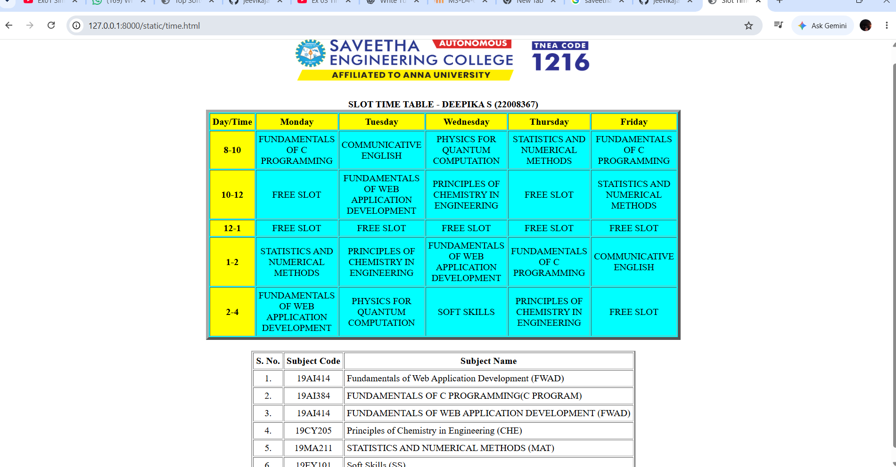

# Ex03 Time Table
## Date:25.11.2026

## AIM:
To write a html webpage to display your slot timetable.

## ALGORITHM
### STEP 1
Create a Django-admin Interface.

### STEP 2g
Create a static folder and inert HTML code.

### STEP 3
Create a simple table using ```<table>``` tag in html.

### STEP 4
Add header row using ```<th>``` tag.

### STEP 5
Add your timetable using ```<td>``` tag.

### STEP 6
Execute the program using runserver command.

## PROGRAM
'''
<html>
<head>
<title>Slot Timetable</title>
</head>
<body>
<center>

</center>
<br>
<table align="center" width="540" cellspacing="2" cellpadding="4" border="5" bgcolor="cyan">
<caption><b>SLOT TIME TABLE - DEEPIKA S (22008367)</b></caption>
<tr align="center">
<th bgcolor="yellow">Day/Time</th>
<th bgcolor="yellow">Monday</th>
<th bgcolor="yellow">Tuesday</th>
<th bgcolor="yellow">Wednesday</th>
<th bgcolor="yellow">Thursday</th>
<th bgcolor="yellow">Friday</th>
</tr>
<tr align="center">
<th bgcolor="yellow">8-10</th>
<td>FUNDAMENTALS OF C PROGRAMMING</td>
<td>COMMUNICATIVE ENGLISH</td>
<td>PHYSICS FOR QUANTUM COMPUTATION</td>
<td>STATISTICS AND NUMERICAL METHODS</td>
<td>FUNDAMENTALS OF C PROGRAMMING</td>
</tr>
<tr align="center">
<th bgcolor="yellow">10-12</th>
<td>FREE SLOT</td>
<td>FUNDAMENTALS OF WEB APPLICATION DEVELOPMENT</td>
<td>PRINCIPLES OF CHEMISTRY IN ENGINEERING</td>
<td>FREE SLOT</td>
<td>STATISTICS AND NUMERICAL METHODS</td>
</tr>
<tr align="center">
<th bgcolor="yellow">12-1</th>
<td>FREE SLOT</td>
<td>FREE SLOT</td>
<td>FREE SLOT</td>
<td>FREE SLOT</td>
<td>FREE SLOT</td>
</tr>
<tr align="center">
<th bgcolor="yellow">1-2</th>
<td>STATISTICS AND NUMERICAL METHODS</td>
<td>PRINCIPLES OF CHEMISTRY IN ENGINEERING</td>
<td>FUNDAMENTALS OF WEB APPLICATION DEVELOPMENT</td>
<td>FUNDAMENTALS OF C PROGRAMMING</td>
<td>COMMUNICATIVE ENGLISH</td>
</tr>
<tr align="center">
<th bgcolor="yellow">2-4</th>
<td>FUNDAMENTALS OF WEB APPLICATION DEVELOPMENT</td>
<td>PHYSICS FOR QUANTUM COMPUTATION</td>
<td>SOFT SKILLS</td>
<td>PRINCIPLES OF CHEMISTRY IN ENGINEERING</td>
<td>FREE SLOT</td>
</tr>
</table>
<br>
<table align="center" cellspacing="2" cellpadding="4" border="2">
<tr align="center">
<th>S. No.</th>
<th>Subject Code</th>
<th>Subject Name</th>
</tr>
<tr>
<td align="center">1.</td>
<td align="center">19AI414</td>
<td>Fundamentals of Web Application Development (FWAD)</td>
</tr>
<tr>
<td align="center">2.</td>
<td align="center">19AI384</td>
<td>FUNDAMENTALS OF C PROGRAMMING(C PROGRAM)</td>
</tr>
<tr>
<td align="center">3.</td>
<td align="center">19AI414</td>
<td>FUNDAMENTALS OF WEB APPLICATION DEVELOPMENT (FWAD)</td>
</tr>
<tr>
<td align="center">4.</td>
<td align="center">19CY205</td>
<td>Principles of Chemistry in Engineering (CHE)</td>
</tr>
<tr>
<td align="center">5.</td>
<td align="center">19MA211</td>
<td>STATISTICS AND NUMERICAL METHODS (MAT)</td>
</tr>
<tr>
<td align="center">6.</td>
<td align="center">19EY101</td>
<td>Soft Skills (SS)</td>
</tr>
</table>
</body>
</html>'''

## OUTPUT


## RESULT
The program for creating slot timetable using basic HTML tags is executed successfully